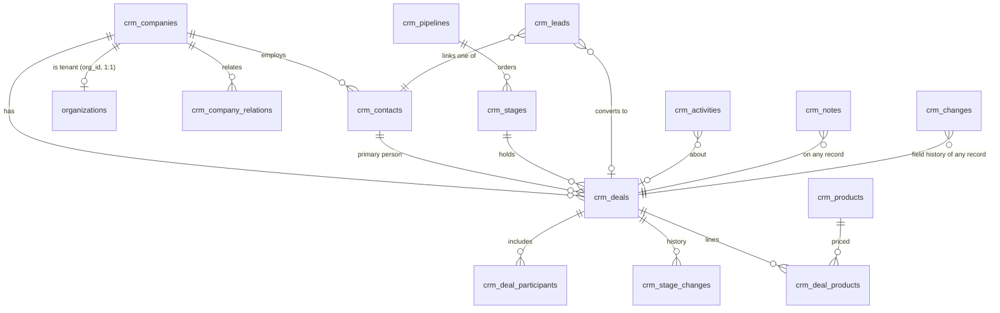

# 07 — Implementation plan

Rewritten 2026-10-04 at Tor's request («Restart with a solid plan and rewrite», DEC-49). Phase 0 is done
(D-218 to D-225, `reports/phase-0.md`). Every remaining phase is planned here to work-package level, in the order it
is built. The work runs as CLAUDE.md says: decisions are taken and logged, with no stops. A phase ends with its gate
flows, a short report and a merge to main once CI is green.

Conventions are the repository's, where they differ from the brief's proposals (A6: "follow the repository
and report the difference"):

| Brief says | Repository does | Plan follows |
| --- | --- | --- |
| RLS with explicit policies on every table | CRM tables have RLS on, **no policy and no grant**; every read and write goes through a `public.admin_crm_*` SECURITY DEFINER RPC that checks `app.crm_can_read/write()` and writes `app.admin_log` (`0055_crm.sql`) | The repository: RLS on, no policy, no client grant, RPC-only access. Stricter than the brief, and no client path can bypass the checks |
| `is_platform_admin(role)` | `app.is_platform_admin(app.platform_role[])`, on `app.admin_role()` which requires aal2 (`0049`) | Same functions; new gates built on them |
| pgTAP via `supabase test db` | Plain-SQL `supabase/tests/*_invariants.sql`, run by psql in CI | One `*_invariants.sql` suite per package |
| Regenerate types after every migration | No generated types; PostgREST rows are Zod-parsed (CLAUDE.md invariant 6) | Zod schemas in `lib/admin/*` updated with each RPC |
| shadcn/ui | `components/admin/ui.tsx` primitives, Tailwind tokens, no shadcn | Admin primitives |
| Storage for files | No storage bucket exists (CMS media are bytea) | One private Storage bucket, read only through signed URLs minted by an RPC that checks the record (WP-1.5) — new to the repo, flagged |

---

## 1. Data model mapping (Part F)

Every new table: schema `app`; RLS on, no policy, no grant to `anon`/`authenticated`; standard columns
`product_id text not null default 'orgpuls'`, `created_at/created_by`, `updated_at/updated_by`,
`deleted_at/deleted_by` (business records), `version int not null default 1` (business records); owner and
visibility where Part C gives the record an owner. Every foreign key has an explicit `on delete`, and every
FK and filter column an index. Immutability triggers follow CLAUDE.md's "permit referential maintenance" rule.
No table has a foreign key, view or function reference to the firewall list (`02-DATABASE.md` §10).

| Part F entity | Decision | Table | Key columns and rules |
| --- | --- | --- | --- |
| organization | Extend (DEC-03) | `app.crm_companies` | + address parts, country, lat/lng/geocoded_at, owner_id (exists), visibility, labels via `crm_label_links`, `custom jsonb`, deleted_at, version, created_by/updated_by; `org_id` made unique (1:1 with the product tenant) |
| contact | Extend | `app.crm_contacts` | + phones `jsonb`, owner_id, visibility, `custom jsonb`, deleted_at, version, created_by/updated_by; keeps `company_id` (a person belongs to at most one organization) |
| organization_relation | New | `app.crm_company_relations` | parent_id, child_id, kind parent/related; unique pair; check parent≠child |
| label | New | `app.crm_labels`, `app.crm_label_links` | set (deal, lead, contact, company), name, colour token; link (label_id, entity, record_id) |
| follower | New | `app.crm_followers` | admin user, entity, record_id; unique |
| pipeline | New | `app.crm_pipelines` | name, sort, visibility groups, card fields `jsonb`, archived_at |
| stage | Extend | `app.crm_stages` | + pipeline_id, probability 0–100, rot_days; existing keys stay as the default pipeline's stages |
| deal | New (DEC-02) | `app.crm_deals` | company_id, primary contact_id, title (only required field), value numeric, currency, pipeline_id, stage, owner_id, expected_close, probability, status open/won/lost, lost_reason_id/lost_text, source, archived_at, `custom jsonb`, visibility, std cols |
| deal_participant | New | `app.crm_deal_participants` | deal_id, contact_id; check ≠ primary |
| deal_stage_history | Extend | `app.crm_stage_changes` | + deal_id, pipeline_id, left_at (days in stage); company_id kept for the migrated history |
| lead | New (brief, Q7 default) | `app.crm_leads` | title, contact_id or company_id (check one), value, currency, owner, source, archived_at, converted_deal_id, `custom jsonb`, std cols |
| lost_reason | New | `app.crm_lost_reasons` | label, sort, archived_at |
| saved_filter | Extend + new | `app.crm_segments` stays for audiences; new `app.crm_filters` | entity, conditions `jsonb` (ALL/ANY groups), visibility private/shared, favourite per user |
| product, product_price, deal_product, revenue_schedule | New | `app.crm_products`, `crm_product_prices`, `crm_deal_products`, `crm_revenue_schedules` | deal value recalculated by trigger; MRR/ARR/ACV/TCV derived |
| currency, exchange_rate | New | `app.crm_currencies`, `app.crm_exchange_rates` | default NOK; rates dated |
| activity, activity_type, activity_guest | Extend + new | `app.crm_activities` + `crm_activity_types`, `crm_activity_guests` | activities gain type_id, starts_at, duration, owner_id, priority, deal_id/lead_id/project_id (check: one record), done_by; existing `kind` maps to types |
| note, comment, mention | New | `app.crm_notes`, `crm_comments`, `crm_mentions` | sanitized rich text (A7.4), pinned, entity + record_id |
| file | New | `app.crm_files` + private bucket | entity, record_id, storage path, mime, size; download via RPC-minted signed URL |
| changelog | New | `app.crm_changes` | entity, record_id, field, old, new, actor, source (user/automation/api/import/connector/meeting), at; append-only |
| event | Extend | `app.event_catalogue` + `app.growth_events` | CRM families registered (`deal.stage_changed`, …), written in the same transaction as the change; delivery bookkeeping in `app.crm_event_deliveries (event_id, subscriber)` for exactly-once (SF-02) |
| setting | New | `app.crm_setting_defs`, `app.crm_setting_values`, `app.crm_setting_log` | key, type, options, default, scope, applies_to; value history with who and when (A9) |
| custom_field | New | `app.crm_fields` | entity, key, type (16), group, options, required/important/from_stage, description, pipelines, read-only/hidden roles, formula; values in each record's `custom jsonb` with an expression index per filterable field |
| import_job, waitlist_item | New | `app.crm_imports`, `app.crm_import_rows`, `app.crm_waitlist` | rows tagged with import_id for revert; skip rows with reason |
| team, team_member, visibility_group, permission_set | New | `app.crm_teams`, `crm_team_members`, `crm_visibility_groups`, `crm_permission_sets`, `crm_staff_access` | staff only (platform admins), never customer users |
| notification | New | `app.crm_notifications` | admin user, kind, record, read_at; channel prefs per user |
| mail_* , booking, call_log, message, workflow*, sequence*, report*, goal, score*, feed_card, enrichment, credit_ledger, campaign extensions, board/project/task, chatbot/form, visitor, document/signature, meeting/transcript, api_token, oauth, webhook, entitlement, usage_counter, login_log, security_rule | New, in their phase | per Part F names with the `crm_` prefix | detailed at each phase's re-plan |

---

## 2. Decisions taken

The open decisions of the first plan, settled so that no work package waits on them (Claude's calls under DEC-49
unless a DEC is named; Tor overrules by saying so).

| # | Decision | Outcome |
| --- | --- | --- |
| P1 | Staff roles | Done: permission sets as rows, a set per staff member (WP-0.4, DEC-11) |
| P2 | Job runtime | pg_cron and edge functions for every phase. The dispatcher and runner (0199) already carry jobs, with runs counted and failures shown; there is no separate worker |
| P3 | Providers | One adapter per service (§6). Mail and SMS stay on Brevo. Google and Microsoft go through OAuth for mail, calendar, contacts, files and video links. Every other service has an adapter that says «Not connected» until its key is in Vault |
| P4 | Webhook signing | Signed, HMAC-SHA256 with a secret per subscription |
| P5 | Public endpoints | Honeypot on; a per-IP rate limit as a setting with a generous default |
| P6 | Mobile | An installable PWA of the admin CRM: offline queue, Web Push, camera and location from the browser; no app-store accounts |
| P7 | Editor role | Done (WP-0.4) |
| P8 | Exclusion-based gates | Unchanged: changing them changes who sees what, a feature question raised only if a package needs it |
| P9 | `product_id` | Done (WP-0.2) |
| P10 | Admin language | English, with per-user date, number and time-zone formats (CUS-05) |
| OP6 | LinkedIn connector (LEA-06) | LinkedIn offers no messaging API for this use, so LinkedIn steps stay tasks; the messaging inbox covers SMS and WhatsApp |
| Q7 | Lead object | Its own table, `crm_leads` |
| Q13 | k threshold | The product rule: floor 3, default 5 |

## 3. Delivery

- **Migrations** are numbered from `0202` (`0198` and `0201` are main's, DEC-51). Each is applied to a database rebuilt from the
  migrations, the SQL suites run, then it is applied to production whole with `apply_migration`. Afterwards the
  functions it creates or changes must match the local build (md5), and the advisors diff
  (`scripts/audit/advisors-diff.py`) must show only what the package intends. If the connector holds a call, the
  migration is listed in `STATUS.md` until it lands, and the work goes on.
- **Main** takes each phase by PR once CI is green. A long phase merges in the middle too. Phase 0 merges first,
  with the four held parts (`held-parts/`) applied before it.
- **Evidence** for every package:
  - its SQL suite;
  - vitest for pure logic;
  - an admin journey for each user flow it completes;
  - new screens at 1440 and 390 (`scripts/qa/admin-shots.mjs`, into `screens/phase-<n>/` with `report.json`);
  - `en` and `no` messages;
  - its rows in the phase report's security table.
- **Status:** `STATUS.md` after every package — done, in progress, next, migrations waiting, keys wanted.

## 4. Work packages

### Phase 0 — Foundations (done)

WP-0.1 rule settings (0192, D-218) · WP-0.2 record history (0194, D-219) · WP-0.3 soft delete and the restore list
(0195, D-220) · WP-0.4 permission sets, visibility, teams (0196, D-221) · WP-0.5 custom fields (0197, D-222) ·
WP-0.6 event dispatcher (0199, D-223) · WP-0.7 admin test harness (D-224) · WP-0.8 clean-ups (0200, D-225). Gate
accepted (DEC-45). Left: the four held production parts, then the merge.

The Phase 0 features that are partial finish with the packages that bring what they lack:

- CUS-01, CUS-02, CUS-03, CUS-04 and SEC-08 with deals, pipelines and leads (WP-1.1, WP-1.7);
- the contacts' owner with WP-1.5;
- SEC-07's projects area with WP-6.2;
- SEC-09's reassignment and own profile with WP-8.5;
- SF-01's entitlement step with WP-8.6;
- SF-38's translations with WP-1.9, its reports with WP-4.1 and its API with WP-8.1.

### Phase 1 — Sales core (exit gate: UF-01, UF-02, UF-09, UF-10, UF-23, UF-24, UF-29; SF-07, SF-09, SF-10, SF-15, SF-25, SF-26, SF-32, SF-33, SF-35, SF-36, SF-37, SF-45)

| WP | Closes | Migrations | Server and interface | Tests | Depends on |
| --- | --- | --- | --- | --- | --- |
| **WP-1.1 Pipelines and deals (data move)** | PIP-02, PIP-03, SF-35; DEC-02 | `crm_pipelines`; stages gain pipeline_id, probability, rot_days; `crm_deals`; `crm_stage_changes.deal_id`; **data migration**: one deal per company that has a stage, value and owner today, history re-pointed; managed stages (trial/customer) become the company's subscription deal, still driven by the product plan; journeys' `stage_target` and win rate re-based on deal stages | every pipeline RPC moved to deals; compatibility kept for journeys until WP-3 | `crm_deals_invariants.sql`: counts before = after, win rate unchanged on the migrated history, a deal with title only is valid, stage delete moves deals to the chosen target; the five existing pipeline suites updated, not loosened | Phase 0 |
| **WP-1.2 Board, list, forecast** | PIP-01, PIP-05, PIP-06, PIP-07, PIP-10, PIP-11, PIP-13, PIP-14, PIP-15, PIP-16, PIP-17, SF-34 (steps 3 and 6, DEC-45) | labels, lost reasons, archive, waitlist, card fields per pipeline, rotting check job | board paged per stage with activity-status icon, rotting flag, labels; list with columns, sort, inline and bulk edit, export; forecast by week/month/quarter; closed toggle remembered per user | rotting resets on each qualifying action; bulk edit writes one changelog row per deal; a bulk change is reverted from the changelog (CRM-12, DEC-27); forecast totals equal card sums; capacity setting on sends overflow to the waitlist, off by default; a rule setting can answer «warn» as well as block, and a test fails if the anonymity firewall enters the registry (SF-34, DEC-45) | WP-1.1 |
| **WP-1.3 Deal detail** | PIP-04, PIP-08, PIP-09 | participants, followers | header, followers, won/lost, progress bar with days, sidebar sections reorderable, Focus, History filter incl. changelog | follower notified on stage change; participant ≠ primary | WP-1.1, WP-0.2 |
| **WP-1.4 Activities** | ACT-01…07, SF-36, SF-07 | activity types, time/duration/owner/priority, links to deal/lead/company/contact, `crm_notifications`, reminder job | calendar day/week/month with drag, to-do list, bulk create, next-step prompt (per-user switch), in-app + email reminders | one reminder per channel; completion stamps and emits; bulk creates one per record; deal without open activity shows the warning | WP-1.1 |
| **WP-1.5 Records** | CRM-01, CRM-02, CRM-03, CRM-05, CRM-06, CRM-10, CRM-13, CRM-14, CRM-15, SF-33, SF-37 | company and contact extensions, relations, notes/comments/mentions, files + private bucket, geocode cache, source enum widened | detail views with deals/activities/files/notes; timeline view; map (P3); exports CSV/XLSX (`lib/xlsx.ts`) formula-safe and logged | a user who cannot see the record cannot fetch its file; mention of a hidden record sends no content; export rows equal visible rows; parent lists daughters | WP-0.2…0.5 |
| **WP-1.6 Import and merge** | CRM-09, CRM-11, SF-09, SF-10, UF-10 | `crm_imports/import_rows`, match rules, merge RPC | all-entity import with mapping, duplicate preview, skip file, history and revert; duplicate list and compare/merge | every row created, merged or skipped with a reason; revert by import id; merge keeps combined history | WP-1.5 |
| **WP-1.7 Leads** | LEA-01, LEA-02, LEA-03, LEA-04, SF-45 (LEA-05/06 in Phase 2) | `crm_leads`, lead labels; inbound paths (contact form, demo, newsletter) create leads with source | leads inbox with archive toggle; convert lead↔deal moving notes, activities, files | a lead never appears in a pipeline before conversion; conversion carries history | WP-1.1, WP-1.5 |
| **WP-1.8 Search and filters** | PIP-12, SF-25 | `crm_filters`; trigram/tsvector index over CRM tables only | global search grouped by type; ALL/ANY filter builder; saved, shared, favourite | a saved filter returns the same set in pipeline, list and forecast; survey tables never indexed | WP-1.1, WP-0.5 |
| **WP-1.9 Customization remainder** | CUS-05, CUS-06, CUS-08 | currencies and rates; per-user format and time zone; sample records marked and removable | currency on deals and products; sample data in the demo tenant | report in default currency converts every value; sample removal leaves live data | WP-1.1 |

### Phase 2 — Engagement (exit gate: UF-04, UF-06, UF-25)

| WP | Closes | Database | Server and interface | Proof | Depends on |
| --- | --- | --- | --- | --- | --- |
| **WP-2.1 Mail accounts and sync** | COM-02, COM-03, SF-03 | `crm_mail_accounts` (per staff user, provider, OAuth tokens in Vault), `crm_mail_threads`, `crm_mail_messages` (headers, sanitized body, direction), `crm_mail_links` (message to deal, lead, contact or company), a sync cursor per account | connect a Google or Microsoft mailbox; a sync job pulls changes; messages link to records by address; an inbox per user | a re-sync creates no duplicates (provider ids); a contact's message lands on their open deal; a user who cannot see a record cannot read its messages; bodies sanitized (A7.4) | Phase 1 |
| **WP-2.2 Team inbox and BCC drop-box** | COM-01, COM-04, COM-09 | shared mailboxes and members, thread labels and archive, a drop-box address per user | team inbox with assignment, labels, archive and warnings (unanswered, bounced); mail sent to the drop-box address files itself on the record | a bcc'd mail lands on the right record; a shared inbox is visible to its members only | WP-2.1 |
| **WP-2.3 Compose and send** | COM-05, COM-06, COM-07, COM-08 | signatures; templates with merge fields (the CRM's templates extended); scheduled sends and outbox; tracking per message on `crm_sends` | composer on every record, scheduling, outbox, group mail with merge per recipient, opens and clicks on the message | a missing merge field blocks the send and names the field; a scheduled send goes once; tracking follows the tracking setting | WP-2.1 |
| **WP-2.4 Calendar sync, invites, booking** | ACT-08, ACT-09, COM-10, SF-08 | calendar accounts (the mail OAuth), event links on activities, `crm_booking_pages`, slots, bookings | two-way sync of activities and calendars; invites with guests; a public booking page (honeypot, rate-limit setting) that creates the activity and the contact or lead | edits on either side converge; a slot is never booked twice; the public page reads nothing but its own page | WP-2.1, WP-1.4 |
| **WP-2.5 Video links** | COM-11, SF-40 (video) | the video provider per account | «Add video link» on activities and bookings: Google Meet through Calendar, Teams through Graph, Zoom through its adapter | the link is made with the event and removed with it | WP-2.4 |
| **WP-2.6 Calling and messaging** | COM-12, COM-13, LEA-06, SF-28 | `crm_calls` (direction, duration, outcome, recording), `crm_message_threads` and messages (SMS, WhatsApp) | click-to-call and browser calling through Twilio, call logging with outcome, SMS and WhatsApp threads on records, a messaging inbox; LinkedIn steps stay tasks | a call log becomes the record's activity; an inbound text from a known number lands on its contact; an opt-out is honoured | WP-1.4 |
| **WP-2.7 Contact sync and lead email** | CRM-04, LEA-05, SF-29 | contact-sync mapping per account | two-way contact sync with Google and Microsoft (conflict rule a setting); an email-to-lead address; mail from a lead | an edit on either side converges; a contact deleted in the CRM does not come back | WP-2.1, WP-1.7 |

### Phase 3 — Automation (exit gate: UF-05, UF-11, UF-12)

| WP | Closes | Database | Server and interface | Proof | Depends on |
| --- | --- | --- | --- | --- | --- |
| **WP-3.1 Workflow engine** | AUT-09, SF-04 | `crm_workflows`, `crm_workflow_versions` (immutable), `crm_workflow_runs`, `crm_workflow_step_runs` | the executor subscribes to the dispatcher (0199); steps run as a state machine with retries and the loop window; runs and failures on Ops | one run per event and version; a failing step retries, then fails visibly; switching a workflow off stops new runs only | Phase 2 |
| **WP-3.2 Triggers, conditions, timing** | AUT-02, AUT-03, AUT-04, AUT-05, AUT-06 | trigger definitions (event, date), condition groups (the filter builder's ALL/ANY), delays, wait-for, branches | a scheduled scan for date triggers | a date trigger fires once per record and date; a wait-for resumes on its event or times out; a branch takes exactly one path | WP-3.1 |
| **WP-3.3 Actions, templates, sharing** | AUT-07, AUT-08, AUT-10 | the action catalogue, templates, a workflow's owner and visibility | create activity, update field, move stage, send mail, notify, assign, call a webhook; a template gallery; sharing | every action writes the changelog with source «automation»; a template becomes an editable draft | WP-3.1 |
| **WP-3.4 Workflow builder** | AUT-01 | — | the visual builder: steps, validation, a test run against a record, publishing a version | an invalid workflow cannot be published; a test run writes nothing | WP-3.2, WP-3.3 |
| **WP-3.5 Assignment engine** | AUT-11, SF-06 | `crm_assignment_rules`, `crm_assignment_log` | round robin, by field or territory, by load, for leads and deals | the same input assigns the same way and is logged; an absent user is skipped | WP-3.1, WP-1.7 |
| **WP-3.6 Sequences and automated campaigns** | AUT-12, CMP-07, SF-05 | sequences as records (`crm_sequences`, steps, enrollments); today's sequences (0137) moved in | enrol and unenrol, pause on reply, mail, call and LinkedIn steps, campaigns on triggers | a reply pauses the enrollment; an unsubscribe stops it; every existing sequence is carried over | WP-3.1, WP-2.3 |

### Phase 4 — Insight (exit gate: UF-03, UF-13, UF-14, UF-26)

| WP | Closes | Database | Server and interface | Proof | Depends on |
| --- | --- | --- | --- | --- | --- |
| **WP-4.1 Report engine** | INS-01, INS-07, INS-10, SF-14 | metric views in git over CRM tables only; `crm_reports` (definition as data); a query RPC that applies visibility | the report builder: entity, measures, grouping, filters including custom fields; freshness and capacity shown | a report's total equals the list's for the same filter; hidden records are left out; no view reaches the firewall list | Phase 1 |
| **WP-4.2 Charts, dashboards, sharing, export** | INS-02, INS-03, INS-04, INS-08 | `crm_dashboards` and widgets; share links with a token and an expiry | charts, dashboards, sharing with users, teams or a public link, export to CSV, XLSX and PDF | a public link shows its dashboard's aggregates and nothing else; an export equals the view | WP-4.1 |
| **WP-4.3 Goals and forecast reports** | INS-05, INS-06 | `crm_goals` (user or team, period, metric) | goal progress; forecasts weighted by stage probability and by close month | progress equals the metric over the period | WP-4.1, WP-1.2 |
| **WP-4.4 Products and revenue** | CRM-07, CRM-08, SF-32 | `crm_products`, prices, `crm_deal_products`, `crm_revenue_schedules` | the catalogue, deal lines, recurring products and installments, recurring revenue (MRR, ARR, ACV, TCV), deal value from its lines; Orgpuls's own figures through the billing adapter, empty until Stripe exists (DEC-05) | a deal's value equals its lines; schedules sum to the contract value | WP-1.1, WP-1.9 |
| **WP-4.5 Scoring and the feed** | PRO-01, PRO-02, PRO-03, SF-12, SF-13 | score models as rows (lead scoring, 0143, moved in); feed cards | a model editor; a feed of suggested actions to act on or dismiss | a score recomputes when an input changes; acting on a card writes as a normal edit does | WP-4.1 |
| **WP-4.6 Enrichment** | PRO-04, PRO-05, PRO-06, PRO-07, SF-11 | an enrichment cache, a credit ledger | companies from Brønnøysund (built); people through the enrichment adapter; bulk enrichment with credits (a limit setting, unlimited by default); reverse lookup by mail domain | a field a user edited is not overwritten unless the setting says so; the ledger balances | WP-1.5 |

### Phase 5 — Capture and close (exit gate: UF-08, UF-18, UF-19)

| WP | Closes | Database | Server and interface | Proof | Depends on |
| --- | --- | --- | --- | --- | --- |
| **WP-5.1 Web forms and embedding** | LGN-03, LGN-05, SF-17 | `crm_forms` (fields mapped to CRM fields), submissions | a form builder, an embed snippet, consent text per form, honeypot and rate-limit setting; a submission makes a lead or contact | one submission, one lead; consent stored with its text version; nothing loads in the survey flow | WP-1.7 |
| **WP-5.2 Live chat and chatbot** | LGN-01, LGN-02, SF-30 | chat sessions and messages, routing rules, bot flows | the site widget, an agent inbox, routing, a rule-based bot builder (AI answers come in Phase 7) | routing picks an available agent; with none, the visitor gets the form | WP-5.1 |
| **WP-5.3 Visitors and reveal** | WEB-01, WEB-02, WEB-03, WEB-04, SF-18 | visitor companies on `web_events` (IP-to-company adapter) | a visitor inbox ranked by fit and intent; convert to a lead; reveal the company; identification a setting, on by default, and the change to the cookieless design recorded as a deviation (DEC-06) | no tracking in the survey flow; a reveal only with the adapter connected | WP-5.1 |
| **WP-5.4 Prospect search** | LGN-04 | — | search the Brønnøysund register by industry, size and region; add results as companies or leads | an added company is matched by organisation number, never duplicated | WP-1.6 |
| **WP-5.5 Documents** | DOC-01, DOC-02, DOC-04, DOC-06 | document templates, documents, tracked links and their views | templates with merge fields and product tables, PDF rendering, tracked share links, branding | every merge field resolves; a view is logged without storing more than the policy allows | WP-4.4 |
| **WP-5.6 E-signature and cloud files** | DOC-03, DOC-05, SF-20 | signature requests, signers, an audit trail | built-in e-signature (typed or drawn, hash-chained audit, a certificate page); files from Drive and OneDrive through the Phase 2 OAuth | a signed document's hash matches its record; signer order holds when set | WP-5.5, WP-2.1 |

### Phase 6 — Market and deliver (exit gate: UF-17, UF-20)

| WP | Closes | Database | Server and interface | Proof | Depends on |
| --- | --- | --- | --- | --- | --- |
| **WP-6.1 Campaigns complete** | CMP-01, CMP-02, CMP-03, CMP-04, CMP-05, CMP-06, CMP-08, CMP-09, SF-19, SF-39 | campaign blocks as rows, audiences from filters, variants, deliverability records | the builder, templates, audiences, marketing status and consent, scheduling, analytics, deliverability (bounces, complaints, domain checks), insights; today's campaigns extended | a consent-less contact is never sent marketing mail; a variant split is even within one recipient | Phase 3 |
| **WP-6.2 Projects** | PRJ-01, PRJ-02, PRJ-03, PRJ-04, SF-42 | boards, phases, projects, work items, dependencies | boards, a project from a won deal, work items, dependencies and a timeline | a won deal opens its project from a template; a dependency holds its successor | WP-1.1 |
| **WP-6.3 Projects complete** | PRJ-05, PRJ-06, PRJ-07, PRJ-08, PRJ-09 | project templates, health, sharing | templates, health, collaboration and sharing, bulk work and import, project automation and reports | health follows its inputs; an imported board equals its file | WP-6.2, WP-3.3, WP-4.1 |

### Phase 7 — AI (exit gate: UF-07, UF-27)

| WP | Closes | Database | Server and interface | Proof | Depends on |
| --- | --- | --- | --- | --- | --- |
| **WP-7.1 AI gateway** | SF-24 | `crm_ai_calls` (purpose, model, tokens, cost; no message bodies) | the gateway in an edge function on the Anthropic API; cost limits as settings, unlimited by default; outside content never triggers a write; output is applied only where the spec allows | a prompt in an email cannot cause a write; the log holds no body | Phase 1 |
| **WP-7.2 Assistant** | AIA-01, AIA-02, AIA-03, AIA-04, AIA-05, AIA-06, AIA-07, INS-09 | — | assistant chat over CRM data, AI notifications, email writer, summaries and suggested replies, import mapping, integration recommendations, card scanner, AI report generation | the assistant answers only from records the user can see | WP-7.1, WP-4.1 |
| **WP-7.3 Meeting intelligence** | MTG-01, MTG-04, MTG-05, MTG-06, MTG-08, SF-21 | meetings, recordings, transcripts, briefs, suggestions | pre-call brief, transcript upload, transcription through its adapter, recap, CRM update suggestions approved by the user, the meeting workspace | a suggestion changes nothing until approved | WP-7.1, WP-2.4 |
| **WP-7.4 Capture** | MTG-02, MTG-03, MTG-07 | — | a notetaker bot (Recall.ai adapter), desktop capture in the PWA, unscheduled calls | the bot joins only where the consent setting allows | WP-7.3, WP-8.7 |

### Phase 8 — Platform and channels (exit gate: UF-15, UF-16, UF-21, UF-22, UF-28)

| WP | Closes | Database | Server and interface | Proof | Depends on |
| --- | --- | --- | --- | --- | --- |
| **WP-8.1 API** | INT-01, INT-02, INT-03, SF-22 | API tokens (hashed), OAuth apps, rate counters | a REST API over the CRM that applies visibility; personal tokens and OAuth; rate limits as settings with generous defaults | a revoked token is refused; a hidden record is never returned | Phase 1 |
| **WP-8.2 Webhooks** | INT-04, SF-23 | subscriptions, deliveries | signed webhooks on CRM events through the dispatcher, retries, a delivery log | a delivery retries with back-off; the signature verifies | WP-8.1 |
| **WP-8.3 Integrations** | INT-05, INT-06, INT-07, INT-08, INT-09, INT-10, INT-11, COM-14, SF-41 | connector records | Google Workspace, Microsoft 365, Slack and Teams notifications, invoicing (Fiken, Tripletex), Zapier and Make through the API and webhooks, app extensions, the catalogue, the Gmail and Outlook add-ons | a connector switched off leaves the CRM working | WP-8.1, WP-8.2 |
| **WP-8.4 MCP server** | MCP-01, MCP-02, MCP-03 | — | an MCP server exposing CRM tools with per-user tokens and admin controls | a tool call keeps the user's set and visibility; nothing reaches the firewall list | WP-8.1 |
| **WP-8.5 Security** | SEC-01, SEC-02, SEC-03, SEC-04, SEC-05, SEC-06, SEC-10, SEC-11, SF-27, SF-43 | login and device log, security rules | the security dashboard, alerts, rules (IP allow-list and others, off by default), device and login history with remote sign-out, SSO for staff (Entra, Google), more 2FA options, data protection, privacy requests (export, erasure) | a rule off changes nothing; an erasure leaves no personal data behind | WP-8.1 |
| **WP-8.6 Entitlements and usage** | CUS-07, ENT-01, ENT-02, ENT-03, ENT-04, SF-16 | entitlements, usage counters | module switches (CUS-07), feature gating (everything on by default), usage limits (unlimited by default), the usage screen; plans, add-ons and top-ups through the billing adapter once Stripe exists (DEC-05) | the defaults leave every feature working | Phase 1 |
| **WP-8.7 Mobile (PWA)** | MOB-01, MOB-02, MOB-03, MOB-04, MOB-05, MOB-06, MOB-07, MOB-08, SF-31, SF-44 | an offline sync queue | the installable PWA: core screens, focus view, nearby (location), calls and texts with logging, offline edits, capture (camera, card), Web Push | an offline edit syncs once; push follows the user's preferences | WP-1.4, WP-1.5 |

## 5. Order

Phase 0's held parts and merge, then Phase 1 (1.1 first; then 1.2, 1.3, 1.4, 1.5; 1.6 and 1.7 after 1.5; 1.8 after
1.1; 1.9), then Phases 2 to 8 in order, each package after the ones it depends on. The Gmail and Outlook add-ons
(COM-14) move to WP-8.3 because they need the API. 48 packages remain.

## 6. Outside services

Each service sits behind an adapter. It is built and tested against the provider's documented API with recorded
responses, and verified live once its key is in Vault. Until then its screens say «Not connected». Nothing is
invented in their place (CLAUDE.md).

| Service | Packages | Adapter | Activated by |
| --- | --- | --- | --- |
| Brevo: mail and SMS | 2.3, 3.6, 6.1 | built | configured today |
| Google Workspace: Gmail, Calendar, Contacts, Drive, Meet | 2.1, 2.4, 2.5, 2.7, 5.6, 8.3 | Google APIs over OAuth | a Google Cloud OAuth client |
| Microsoft 365: Outlook, Calendar, People, OneDrive, Teams | 2.1, 2.4, 2.5, 2.7, 5.6, 8.3 | Microsoft Graph | an Entra app registration (the product signs customers in with Entra, 0155) |
| Telephony and WhatsApp | 2.6 | Twilio | an account and a number |
| Zoom | 2.5 | Zoom API | a Zoom app |
| IP-to-company | 5.3 | adapter | a provider key |
| Person enrichment | 4.6 | adapter | a provider key |
| AI models | 7.1–7.4 | Anthropic API | an API key |
| Transcription | 7.3 | adapter | a provider key |
| Notetaker bot | 7.4 | Recall.ai | an API key |
| Invoicing | 8.3 | Fiken, Tripletex | API keys |
| Team chat | 8.3 | the product's Slack app and Teams bot | built |

## 7. Test plan (every package)

- **Database:** one `*_invariants.sql` per package in the repository's style, covering structure, RLS
  (enabled, no policy, no grant; anon and customer users denied on every new table), allow/deny per staff role
  and permission set through the RPCs, visibility, triggers, settings in both states, soft delete/restore/purge,
  stale version, each data acceptance criterion; plus `definer_grants_invariants.sql` and the growth firewall
  suite re-run after every migration (A7.16).
- **Unit:** vitest for pure logic (filters, settings evaluation, rotting, forecast totals, merge fields,
  formulas, derived revenue).
- **End-to-end:** Playwright admin journeys per gate flow (WP-0.7).
- **Visual:** every new screen at 1440 and 390 with `scripts/qa/admin-shots.mjs` into `screens/phase-<n>/`, inspected;
  axe and the 390 check through the admin harness (`npm run e2e -- --project admin --project admin-phone`).
- **Gates per push:** `npx tsc --noEmit`, `npm run lint`, `npm run verify:i18n`, `npx next build`, vitest, all
  SQL suites, `supabase db lint`, `node scripts/audit/wiring.mjs`, `npm audit --omit=dev`.
